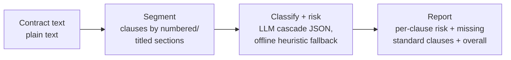

# Contratalupa

A reading glass for contracts. It segments a contract into clauses, classifies
each one, flags risky language, and reports the standard clauses that are
missing — using a provider-agnostic LLM cascade, with an offline heuristic
fallback so it always returns an answer.

The name is a play on *contrato* (contract) and *lupa* (magnifying glass): it
reads a contract the way a careful reviewer would, and explains what it finds.

[](.github/workflows/ci.yml)
[](pyproject.toml)
[](LICENSE)

---

## Why it matters

A contract's risk lives in its clauses: an unlimited-liability clause, an
automatic renewal, a broad indemnification, or a standard protection that is
simply absent. Reading every clause of every contract by hand is slow and
uneven. Contratalupa gives a first pass in seconds — a structured, explainable
view a lawyer can then focus and trust.

Two properties make it suitable for this job:

- **Explainable.** Every clause gets a type, a risk level, and a one-line reason.
  Nothing is a black box.
- **Resilient.** It uses an LLM when one is reachable, and falls back to
  deterministic keyword heuristics when none is — so a missing API key or a
  provider outage never leaves you without a result.

## How it works



1. **Segment (`segment.py`).** Splits the text into clauses by recognising
   numbered or titled sections (`1.`, `1.1`, `Section 3`, `ARTICLE IV`), falling
   back to paragraph breaks for unstructured text.
2. **Analyse (`analyzer.py`).** For each clause, it asks the LLM for a strict
   JSON verdict (type, risk, rationale). If the LLM is unreachable or its answer
   cannot be parsed, it falls back to keyword heuristics. It then compares the
   detected clause types against a standard-clause checklist to report what is
   missing.
3. **Orchestrate (`llm/`).** A cascade tries each provider in order
   (Anthropic → OpenAI → Gemini → DeepSeek → Ollama); the first to answer wins,
   and a provider with no key or a transient failure is skipped.

## How the risk score and the JSON contract work

**Risk heuristic.** `clauses.py` holds a weighted list of risk phrases — e.g.
`unlimited liability` (+3), `sole discretion` (+2), `automatically renew` (+2),
`without limitation` (+1). A clause's weight is the sum of the phrases it
contains; `weight ≥ 3 → high`, `≥ 1 → medium`, `0 → low`, and the matched phrases
become the rationale. This runs as the offline fallback *and* as a sanity signal
regardless of the LLM.

**Strict JSON, validated not trusted.** The LLM is asked for exactly
`{"type", "risk", "rationale"}` with the allowed values enumerated in the prompt.
On the way back the analyser extracts the first `{...}` block (models sometimes
wrap JSON in prose), parses it, and **validates** each field against the
`ClauseType` and `Risk` enums — an out-of-vocabulary `type` is coerced to the
heuristic type, a bad `risk` to the heuristic risk, and a response with no JSON
is treated as a provider failure that triggers the fallback. The model proposes;
the vocabulary disposes. Every finding records its `source` (`llm` or
`heuristic`) so a reader knows how it was produced.

**Missing clauses** are a set difference: `STANDARD_CLAUSES − detected_types`.
It surfaces absence (no limitation-of-liability, no data-protection clause), which
is often where the real risk hides, and is treated as a prompt for human review,
not a verdict.

This is decision-support, not legal advice: it gives a fast, explainable first
read for a lawyer to focus and trust, never an automated judgement.

## Quick start

```bash
python -m venv .venv && source .venv/bin/activate
pip install -e ".[dev]"

# Analyse a built-in sample contract (works offline, no API key needed):
python -m contratalupa.cli demo

# Analyse your own contract text file:
python -m contratalupa.cli analyze path/to/contract.txt

# Run the HTTP API:
uvicorn contratalupa.main:app --reload
```

Example API call:

```bash
curl -s -X POST localhost:8000/analyze -H 'content-type: application/json' \
  -d '{"text": "1. Liability. The Provider shall bear unlimited liability..."}'
```

## Using real LLM providers

The analyser is provider-agnostic. Set the API keys for the providers you want
to use; the cascade skips any provider without a key:

```bash
export ANTHROPIC_API_KEY=...
export OPENAI_API_KEY=...
# GEMINI_API_KEY, DEEPSEEK_API_KEY, or a local OLLAMA_HOST are also supported
```

The order and set of providers is configurable with `CL_LLM_SPEC` (see
`.env.example`). With no keys set, everything still runs on the offline
heuristics.

## Configuration

Settings load from environment variables with the `CL_` prefix:

| Variable            | Default                                      | Meaning                          |
| ------------------- | -------------------------------------------- | -------------------------------- |
| `CL_LLM_SPEC`       | `anthropic,openai,gemini,deepseek,ollama`    | Provider cascade, tried in order |
| `CL_LLM_MAX_TOKENS` | `400`                                        | Max tokens per clause call       |

Provider API keys are read from their own environment variables
(`ANTHROPIC_API_KEY`, `OPENAI_API_KEY`, `GEMINI_API_KEY`, `DEEPSEEK_API_KEY`) and
are never hard-coded.

## Testing

```bash
ruff check contratalupa tests
pytest --cov=contratalupa --cov-report=term-missing --cov-fail-under=80
```

The suite covers segmentation, the clause vocabulary, the analyser (both the LLM
JSON path with a fake client and the heuristic fallback), the LLM cascade and its
fallback behaviour, the HTTP API, and the CLI. Nothing in the tests touches a
real network.

## A note on scope

Contratalupa is a decision-support tool, not legal advice. It gives a fast,
explainable first read; a qualified lawyer makes the call. A production
deployment would add clause-level citations, a configurable checklist per
contract type and jurisdiction, and human-in-the-loop review of every flagged
clause.

## Documentation

- `docs/architecture.md` — the full picture and the data flow.
- `docs/adr/` — the main design decisions and why they were made.
- `docs/estudio/` — a study guide in Spanish, for learning the project in depth.

## License

[MIT](LICENSE) © Angelo David Padilla Romero
