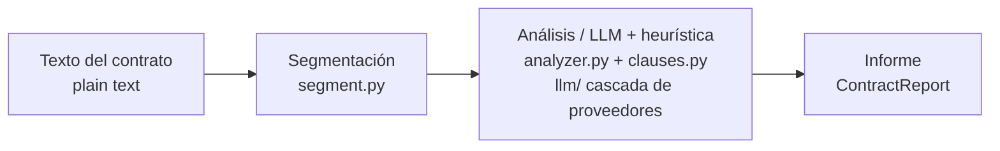

# 04 — Arquitectura y decisiones de diseño

## Las piezas, de principio a fin

Por encima: la **API HTTP** (`main.py`, FastAPI) y la **CLI** (`cli.py`, demo con
un contrato de ejemplo y análisis de un fichero).

## Flujo

1. `segment(texto)` → lista de `Clause`.
2. Para cada cláusula, `ClauseAnalyzer.analyze_clause`:
   - pide al LLM un veredicto JSON; si falla o es ilegible, usa heurísticas.
3. `analyze` junta los hallazgos, calcula las cláusulas que faltan, los recuentos
   de riesgo y el riesgo global → `ContractReport`.

## Decisión 1: LLM agnóstico del proveedor con cascada

Explicada en la guía 02. Una interfaz `LLMClient`, muchos adaptadores, una
cascada con fallback. Libertad (cambiar proveedores por config) y resiliencia
(uno caído no detiene nada). Es **inversión de dependencias**.

## Decisión 2: LLM principal + respaldo determinista

Explicada en la guía 03. El LLM es el principal; las heurísticas son la red de
seguridad y el cruce de verificación. Nunca nos quedamos sin respuesta y nunca
confiamos a ciegas. Cada hallazgo marca su `source`.

## Decisión 3: contrato JSON estricto con el modelo

Explicada en la guía 03. Pedimos solo un objeto JSON con `type`, `risk`,
`rationale`, con valores permitidos en el prompt, y validamos la respuesta contra
el vocabulario. Parseo predecible, salida corta y barata (pocos tokens por
cláusula).

## Decisión 4: avisar de las cláusulas que faltan

Explicada en la guía 03. Una lista de verificación (`STANDARD_CLAUSES`) y una
diferencia de conjuntos. Hace visible la **ausencia**, que a menudo es el mayor
riesgo. Es configurable por tipo de contrato y jurisdicción.

## Decisión 5: configuración por variables de entorno

`config.py` usa `pydantic-settings` con prefijo `CL_`. El orden de proveedores
(`CL_LLM_SPEC`) y el límite de tokens (`CL_LLM_MAX_TOKENS`) se controlan desde el
entorno. Las claves de API viven en sus propias variables, nunca en el código.

## Puntos de extensión

- **Lista de verificación:** `STANDARD_CLAUSES` por tipo de contrato y país.
- **Pistas de riesgo:** añadir frases a `RISK_PHRASES`.
- **Proveedores:** un adaptador nuevo que implemente `LLMClient` y una línea en el
  registro.
- **Prompt:** vive en un solo sitio de `analyzer.py`; se ajusta sin tocar el
  resto.

## Por qué no hay blockchain aquí

No todos los proyectos necesitan una cadena. Este es un proyecto de
**orquestación de LLM** en el dominio legal/gobierno. Meter un contrato
inteligente aquí sería artificial. La buena ingeniería es usar la herramienta
adecuada: aquí, una cascada de LLM resiliente y explicable.

## Para fijar la idea

- Capas claras: segmentar → analizar → informar.
- LLM agnóstico + cascada; LLM principal + heurística de respaldo; JSON estricto;
  lista de cláusulas que faltan.
- Sin blockchain: la herramienta adecuada para el problema adecuado.
